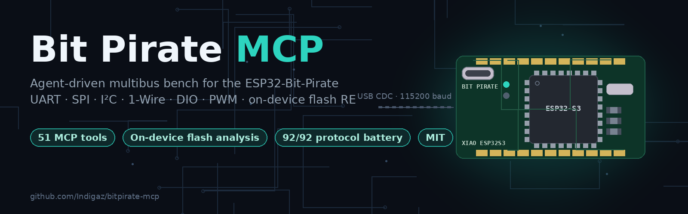

<p align="center">
  
</p>

An [MCP](https://modelcontextprotocol.io/) server for the
[ESP32-Bit-Pirate](https://github.com/geo-tp/ESP32-Bit-Pirate) - an open-source,
ESP32-S3-based clone of the Bus Pirate multibus tool. It exposes the bench's
UART, SPI (incl. the on-device flash shell), I2C (master **and** slave),
1-Wire, GPIO, PWM and scope/measure capabilities as MCP tools over stdio, so
an AI agent can probe, dump and analyze firmware on a target board end-to-end:
attach a device to the ESP32, let the agent drive the tools, and get extracted
binaries and analysis out the other end.

A port of [buspirate-mcp](https://github.com/mplogas/buspirate-mcp)
(Marc Plogas, MIT) from the BusPirate 6's BPIO2 binary protocol to the
Bit-Pirate's text-console protocol. The tool/dispatch/session/safety layers are
largely kept verbatim; the device layer was replaced and re-grounded in the
Bit-Pirate v1.8 firmware source.

## What makes this different from the upstream

| | buspirate-mcp (BP6) | bitpirate-mcp (ESP32-Bit-Pirate) |
|---|---|---|
| Transport | BPIO2 flatbuffers over a 2nd CDC port | Plain text console at 115200 baud (single CDC port) |
| Device layer | `hardware.py` (BPIO2 SDK, submodule) | `bitpirate_hardware.py` (prompt/marker-aware console driver, no vendor deps) |
| Flash work | Manual JEDEC sequences + host-side page program/erase | **Native firmware flash shell**: probe, on-device analysis, search, strings, read, raw dump, patch write, full erase |
| On-device analysis | None | `BinaryAnalyzer` in firmware: file signatures, secret patterns (keys/hashes/URLs), entropy summary |
| Raw transactions | `spi_transfer` byte arrays | BP6-style instruction syntax `[0x9F r:3]` dispatched by the firmware |
| Logic analyzer | FALA (5 tools, 75 MHz, 8 ch) | Removed - no FALA; `verify_connection` uses the DIO `measure` edge/frequency detector; `measure_pin`/`measure_frequency`/`capture` cover DIO timing |
| Power supply | Hardware PSU (3 tools) | None on the bare devkit - tools report `psu: unavailable` gracefully |
| Signal timing | Fast binary protocol | ~2 s per menu round-trip (firmware main-loop latency); raw dump is serial-bottlenecked (~11.5 KB/s) |

Gains: the Bit-Pirate is *stronger* for RE than the BP6 in one key respect -
the firmware does binary analysis **on the device** (39 secret patterns, file
signature table, entropy), so `spi_flash_analyze` returns findings without
pulling the whole image first. It is also cheaper (~$15 board + devkit vs $100+).

## Architecture

```
MCP client (Claude Code, Hermes, any MCP host)
  |  stdio
  v
server.py            tool definitions + dispatch + safety tiers + session mgmt
  |
  v
tools.py             51 tool implementations (protocol-agnostic where possible)
  |
  v
bitpirate_hardware.py  THE device layer (the only firmware-specific module)
  |  pyserial, /dev/ttyACM0 @115200
  v
ESP32-S3 running ESP32-Bit-Pirate v1.8 text console
```

The console driver has two read modes, both grounded in the firmware's actual
output:

- **Prompt-aware reads** - command, then read until the trailing mode prompt
  (`DIO> `, `SPI> `, …) matches at the *end* of the transcript. Used for mode
  switches, DIO, and instruction-syntax transactions.
- **Marker-aware reads** - shell flows (flash shell, config wizard) don't end
  at a mode prompt; the driver reads until a known completion marker
  (`=== SPI Flash Shell ===`, `SPI Flash Dump: Done.`, `SPI configured.`, …)
  and answers intermediate prompts in the exact order the firmware asks them.

A quadratic-echo line-length guard (250 chars) protects the firmware's
`getLine` input path.

Every command string in the driver was taken from the v1.8 firmware source -
`SpiFlashShell.cpp`, `SpiController.cpp`, `DioController.cpp`,
`UserInputManager.cpp`, `ActionDispatcher.cpp` - not assumed.

## Tools (51)

Safety tiers: **read-only** (full autonomy), **allowed-write** (autonomous,
logged), **approval-write** (blocks until a human confirms with
`_confirmed: true` *and* the firmware's own confirmation prompts are driven -
double-gated for destructive operations).

### Session & UART
| Tool | Tier | Notes |
|---|---|---|
| `list_devices` | read-only | USB CDC console ports |
| `verify_connection` | read-only | DIO `measure` edge/frequency detector on TX/RX |
| `scan_baud` | read-only | baud probing over a UART session |
| `open_uart` / `send_command` / `close_uart` | allowed-write | console interaction with targets |
| `read_output` | read-only | non-blocking capture of target output |
| `enter_download_mode` | allowed-write | boot/EN pin toggling (0-48 GPIO) |
| `read_flash` | allowed-write | esptool through the firmware UART **bridge** |

### SPI (incl. on-device flash shell)
| Tool | Tier | Notes |
|---|---|---|
| `open_spi` / `close_spi` | allowed-write | mode switch + engagement session; close exits the flash shell |
| `spi_probe` | read-only | firmware flash probe: JEDEC ID, manufacturer, model, capacity |
| `spi_read` | read-only | region read as hexdump |
| `spi_dump` | read-only | **raw full-chip dump to a file** - the workhorse for RE |
| `spi_write` | **approval-write** | patch write from file/hex/ASCII, auto-erase option |
| `spi_transfer` | read-only | BP6-style instruction `[0x9F r:3]` (JEDEC, status, custom sequences) |
| `spi_config` | allowed-write | MOSI/MISO/SCLK/CS pins + 1-80 MHz + WP/HOLD (NVS-persisted) |
| `spi_flash_analyze` | read-only | on-device BinaryAnalyzer: file signatures, secrets, entropy |
| `spi_flash_search` | read-only | string search (1-32 bytes) with context |
| `spi_flash_strings` | read-only | printable-string extraction |
| `spi_flash_erase` | **approval-write** | full-chip erase - destructive |

### I2C (master + slave)
| Tool | Tier | Notes |
|---|---|---|
| `open_i2c` / `close_i2c` | allowed-write | engagement session |
| `i2c_ping` | read-only | single-byte ping (ack/no-ack) |
| `i2c_scan` | read-only | bus scan |
| `i2c_read` / `i2c_dump` | read-only | register read / range dump |
| `i2c_write` | **approval-write** | register write |
| `open_i2c_slave` / `close_i2c_slave` | allowed-write | bench as **I2C slave**: a target master can write to / read from the bench |
| `i2c_slave_log` | read-only | mid-session capture of what a target master sent |

### 1-Wire (incl. DS18B20 lifecycle)
| Tool | Tier | Notes |
|---|---|---|
| `open_1wire` / `close_1wire` | allowed-write | engagement session |
| `onewire_search` | read-only | ROM search (multi-device aware) |
| `onewire_ping` | read-only | presence detect |
| `onewire_temp` | read-only | DS18B20 convert + read (CRC-checked by firmware) |
| `onewire_read` | read-only | scratchpad read-back |
| `onewire_write_spad` | allowed-write | scratchpad program (e.g. temperature-set for test emulators) |

### DIO, PWM & measurement
| Tool | Tier | Notes |
|---|---|---|
| `set_pin` / `read_pin` | allowed / read | GPIO drive and sample |
| `pulse` | allowed-write | timed pulse on a pin |
| `pull_up` / `pull_down` | allowed-write | weak-pull configuration |
| `pwm_set` / `pwm_stop` | allowed-write | hardware PWM (50 Hz-~100 kHz) |
| `servo_set` | allowed-write | 50 Hz pulse-width servo control |
| `measure_pin` | read-only | edge/level timing on a pin |
| `measure_frequency` | read-only | frequency measurement |
| `capture` | read-only | bounded logic capture (hex) |

### PSU (hardware-dependent)
| Tool | Tier | Notes |
|---|---|---|
| `set_voltage` / `set_power` | **approval-write** | report `psu: unavailable` (no PSU on the bare devkit) |

## Install

```bash
# any Python 3.10+ (tested on 3.11)
git clone https://github.com/Indigaz/bitpirate-mcp
cd bitpirate-mcp
python3 -m venv .venv          # or: uv venv --python 3.11 .venv
.venv/bin/pip install -e .
```

Register with an MCP host (`.mcp.json`):

```json
{
  "mcpServers": {
    "bitpirate": {
      "command": "/absolute/path/to/bitpirate-mcp/.venv/bin/python",
      "args": ["-m", "buspirate_mcp"]
    }
  }
}
```

Board requirements: an ESP32-S3 devkit running
[ESP32-Bit-Pirate](https://github.com/geo-tp/ESP32-Bit-Pirate) v1.x,
exposing a USB CDC console (`/dev/ttyACM0` on Linux). No pin configuration
needed for first use - the firmware keeps its SPI pin map in NVS
(defaults on a typical Bit-Pirate build: MOSI 40, MISO 39, SCLK 41, CS 4,
20 MHz, WP 7); `spi_config` re-points any free GPIO.

## Typical RE workflow

1. Attach a target to the bench (SPI flash via clip, or I2C bus).
2. `spi_probe` - identify the chip (ID, manufacturer, capacity).
3. `spi_dump` → `~/re-lab/<target>/flash.bin` - raw image off the bus.
4. `spi_flash_analyze` / `spi_flash_strings` / `spi_flash_search` - on-device
   findings (what firmware, embedded keys, embedded binaries).
5. Hand the image to your static-analysis tooling (Ghidra, REA, etc.).

## Testing & verification

- **287 unit tests**, all passing. The device layer is tested with a
  **transcript-driven protocol mock** (`FakeSerial`): scripted firmware
  transcripts are released only after the triggering command is written,
  simulating real round-trip latency so command/response pairing cannot bleed
  across commands. The mock is a FIFO of (line → response) so repeated prompts
  (e.g. `y`/`y`) resolve in firmware order, and it accepts raw bytes for the
  dump path.
- **Live-verified on hardware** (ESP32-S3 devkit + Bit-Pirate v1.8, no target
  attached - no-chip paths): DIO read, edge counter, drive-HIGH/LOW
  self-test; instruction syntax `[0x9F r:3]` (floating bus, correct);
  flash shell probe (no-chip detection), analyze short-circuit, clean shell
  exit. Reproduce: `scripts/smoke_live.py`, `scripts/smoke_live_spi.py`
  (read-only by design).
- **Protocol battery: 92/92 steps green** on a two-board rig. A second
  ESP32-S3 running a custom `rig-responder` firmware acts as the target side
  (SPI slave, I2C slave + master, 1-Wire DS18B20 emulator with
  scratchpad/RAM, GPIO mirror witness, scope). Every checked value is derived
  from a known write - no flake-tolerant assertions. `scripts/protocol_battery.py`
  (console 31 steps + mcp 61 steps).

## Roadmap

### Shipped

| Phase / Tier | What landed |
|---|---|
| Phase 1–2 | Console driver (prompt/marker-aware), safety tiers, UART session tools |
| Phase 3 | I2C host tools + 1-Wire search/read |
| Phase 4 | `read_flash` via the firmware UART bridge (esptool) |
| Phase 5 | Scope/measure: `measure_pin`, `measure_frequency`, `capture` |
| Tier 3 | DIO digital + PWM: `set_pin`, `read_pin`, `pulse`, `pull_up`, `pull_down`, `pwm_set`, `pwm_stop` |
| Tier 4 | Bidirectional I2C (ping + bench-as-slave) + `servo_set` |
| Tier 5 | 1-Wire DS18B20 lifecycle: `onewire_ping`, `onewire_temp`, `onewire_write_spad` |
| Tier 6 | Deterministic end-to-end verification: the 92-step protocol battery on a real two-board rig |

### Open upstream PRs (geo-tp/ESP32-Bit-Pirate)

| PR | Fix |
|---|---|
| [#201](https://github.com/geo-tp/ESP32-Bit-Pirate/pull/201) | onewire: add `xfer` command (raw 1-Wire transfer primitive) |
| [#202](https://github.com/geo-tp/ESP32-Bit-Pirate/pull/202) | uart: add `uread` bounded read; stop redundant UART re-init |
| [#203](https://github.com/geo-tp/ESP32-Bit-Pirate/pull/203) | scope/measure: bounded `wizreport`, `freqms`, `logiccap` commands for the MCP driver |
| [#204](https://github.com/geo-tp/ESP32-Bit-Pirate/pull/204) | hiz: actually release DIO/OneWire/UART pins on mode exit |

### Next (MCP-side, small)

- `dio_toggle` - invert a pin without re-driving a level.
- `uart_ping` - timed (5 s) capture to characterize a DUT's baud/echo behavior.
- `i2c_transfer` - bracket instruction syntax for raw I2C sequences
  (parity with `spi_transfer`).

### Proposed features (by effort)

- **XMODEM send/receive tools** - the firmware already implements xmodem;
  expose it as MCP tools for AT-style DUT firmware flashing.
- **`uart_read_lines`** - line-buffered reads (AT command shells, `OK`-gated
  targets).
- **`dio_shift`** - clock a byte out across N pins (shift-register DUTs).
- **1-Wire depth** - multi-device search results, DS2408 (8-channel I/O),
  DS2431/DS2433 EEPROM read/write.
- **`spi_slave`** - bench as SPI slave so a *target* master can drive the bench
  (completes the bidirectional matrix: I2C slave exists, SPI slave does not).
- **SPI EEPROM shell** - 24xx/25xx EEPROM read/write (matches common bench
  EEPROMs; carries over from the original Phase 3).
- **`capture` output modes** - save-to-file + ASCII waveform rendering so an
  agent can actually *see* the signal.
- **`analog_read`** - ESP32-S3 ADC path (upstream firmware PR; the S3 has ADCs
  the Bit Pirate firmware doesn't use yet).
- **`spi_flash_diff`** - compare two dumps (find what a patch changed).
- **Bluetooth mode tools** - the firmware's S3 BT mode is unexposed; upstream
  work, larger effort, listed for completeness.

### Packaging (carried)

- Rename the `buspirate_mcp` package to `bitpirate_mcp`, PyPI publish, CI.

## Credits

- **Upstream**: [buspirate-mcp](https://github.com/mplogas/buspirate-mcp) by
  [Marc Plogas](https://github.com/mplogas) (MIT) - the tool/dispatch/session/
  safety architecture it builds on.
- **Hardware & firmware**: [ESP32-Bit-Pirate](https://github.com/geo-tp/ESP32-Bit-Pirate)
  by geo-tp (the console protocol, flash shell and analyzer this port drives).
- **Port to the ESP32-Bit-Pirate**: designed and implemented by
  [Hermes Agent](https://github.com/NousResearch/hermes-agent) (Nous Research)
  - the LLM agent driving this bench - under direction by
  [Christian Brooks](https://github.com/Indigaz) (Indigaz), who owns the
  hardware, set the goals, and reviews the work.
- **Method**: every firmware-facing string is grounded in v1.8 source; the
  whole port is test-first (287 unit tests) and verified end-to-end on a real
  two-board rig (92/92 protocol battery) before each phase ships.

## License

MIT - see [LICENSE](LICENSE). Upstream copyright (c) Marc Plogas;
port copyright (c) 2026 Hermes Agent (Nous Research) / Christian Brooks.
